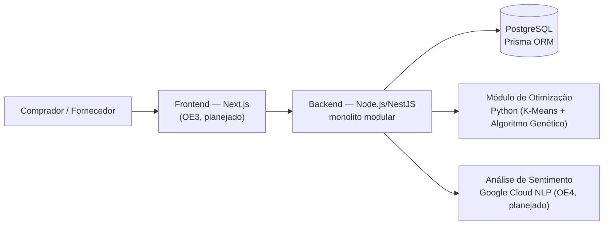

# Compra Coletiva B2B — Logística Amazônica

### TCC (UFJ) — plataforma de compra coletiva com otimização de frete e reputação por IA

> Status: em desenvolvimento (TCC 2, entrega dez/2026). Este repositório documenta o problema, a arquitetura proposta e reúne os módulos já implementados do protótipo — sem inflar o que ainda está no cronograma.

## O Problema

A Região Norte do Brasil sofre com o chamado **"Custo Norte"**: uma variável de custo proibitiva gerada pelo isolamento geográfico e pela fragmentação logística (forte dependência de transporte fluvial e aéreo). Isso cria barreiras de entrada para pequenos empreendedores e fortalece oligopólios de conveniência, onde a meritocracia técnica frequentemente perde para patrimonialismo e nepotismo — inclusive dificultando o acesso a equipamentos de diagnóstico em saúde pública.

Soluções parciais já existem, mas não resolvem o problema como um todo:
- Iniciativas logísticas de grandes marketplaces (ex: Mercado Livre) beneficiam majoritariamente seus próprios vendedores, não o comércio B2B local.
- Práticas informais de compartilhamento de frete entre empresas do Polo Industrial de Manaus (PIM) existem, mas sem otimização ou transparência.
- Pesquisas acadêmicas sobre algoritmos de logística tratam o problema isoladamente, sem integrá-lo a uma plataforma real com reputação e transparência.

## A Solução

Uma plataforma full-stack de **compra coletiva B2B**: agrega a demanda de múltiplos compradores em lotes compartilhados de frete, usando otimização algorítmica para decidir o agrupamento e o momento ideal de fechamento de cada lote — reduzindo o custo por comprador via economia de escala.

Dois pilares tecnológicos sustentam a proposta:
- **Otimização logística**: um algoritmo genético de duas etapas (agrupamento K-Means + otimização) para decidir a composição dos lotes, baseado em variações do Problema de Roteamento de Veículos (VRP).
- **Reputação meritocrática**: análise de sentimento (PLN) sobre avaliações textuais de fornecedores, cruzada com dados operacionais (prazo, reclamações), para compor um índice de confiabilidade transparente e resistente a fraude — valorizando capital técnico em vez de influência política.

## Objetivos Específicos (OEs) e status

| OE | Descrição | Status |
|---|---|---|
| OE1 | Algoritmo genético de otimização de lotes (K-Means + GA, Python/DEAP) | ✅ Protótipo funcional — [`optimization/`](./optimization) |
| OE2 | Modelagem relacional multi-ator (comprador, fornecedor, hub, lote) em PostgreSQL/Prisma | ✅ Schema + seed funcionais — [`database/`](./database) |
| OE3 | Interface em Next.js com rateio de frete auditável pelo usuário | 🔜 Planejado (out/2026) |
| OE4 | Análise de sentimento (API de linguagem natural) para índice de reputação | 🔜 Planejado (nov/2026) |

## Arquitetura



**Stack técnico:** Next.js (frontend), Node.js/NestJS (backend, monolito modular), PostgreSQL + Prisma ORM (dados multi-ator), Python + DEAP + scikit-learn (otimização), Google Cloud Natural Language API (análise de sentimento, planejado), deploy alvo em Vercel/Railway/Supabase.

## Estrutura do repositório

```
optimization/   → algoritmo genético de otimização de lotes (OE1)
database/       → schema Prisma multi-ator + seed de demonstração (OE2)
```

## Módulo de Otimização (OE1)

Simula pedidos de compradores distribuídos entre hubs logísticos (Manaus, Santarém, Belém), agrupa candidatos a lote via **K-Means** e usa um **algoritmo genético (DEAP)** para decidir a composição final dos lotes, minimizando custo fixo de despacho + custo variável por volume, respeitando a capacidade do modal.

> Os custos por hub usados no script são **simulados**, para fins de prototipagem — não são cotações reais de frete.

```bash
cd optimization
pip install -r requirements.txt
python genetic_algorithm.py
```

Saída de uma execução real do protótipo (60 pedidos simulados):

```
Pedidos simulados: 60
Clusters candidatos (pos K-Means): 12
Custo SEM compra coletiva (baseline): R$ 143,527.90
Custo COM lotes otimizados (GA):      R$ 36,127.90
Economia estimada: R$ 107,400.00 (74.8%)
```

## Modelagem de Dados (OE2)

Schema Prisma com os quatro atores centrais — `Buyer`, `Supplier`, `Hub`, `Lot` — e uma tabela de `Participation` que guarda o **rateio de frete** de cada comprador em um lote, calculado proporcionalmente ao volume. Usa SQLite para simplificar a execução local; em produção o banco é PostgreSQL.

```bash
cd database
npm install
cp .env.example .env
npm run migrate   # cria o banco e aplica o schema
npm run seed       # popula com um cenário de exemplo e imprime o rateio calculado
```

Saída de uma execução real do seed:

```
Lote ...  | Hub: Manaus | Volume total: 25 m3 | Custo total: R$ 4175.00
Rateio por comprador:
  - Comercio A: 8 m3 -> R$ 1336.00
  - Comercio B: 5 m3 -> R$ 835.00
  - Comercio C: 12 m3 -> R$ 2004.00
```

## Referencial Teórico (resumo)

A pesquisa se apoia em seis eixos: economia regional e falhas de mercado na Amazônia; economia compartilhada aplicada a compras coletivas B2B; algoritmos de otimização logística (Algoritmos Genéticos sobre variações do VRP); engenharia de software (monolito modular, Next.js + NestJS + PostgreSQL); e análise de sentimento para reputação antifraude.

## Cronograma (TCC 2)

| Mês | Entrega |
|---|---|
| Ago/2026 | Modelagem do banco (PostgreSQL/Prisma) e preparação do ambiente |
| Set/2026 | Módulo Python de otimização (algoritmos genéticos) e backend NestJS |
| Out/2026 | Experimentos comparativos e desenvolvimento do frontend (Next.js) |
| Nov/2026 | Integração da análise de sentimento e deploy (Vercel/Railway/Supabase) |
| Dez/2026 | Redação final e defesa |

## Licença

MIT — veja [LICENSE](./LICENSE). Trabalho acadêmico desenvolvido para o TCC do curso de Ciência da Computação (UFJ).
