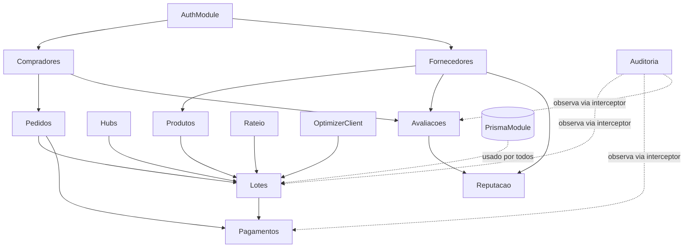
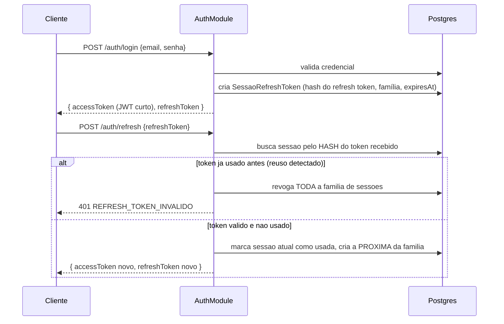
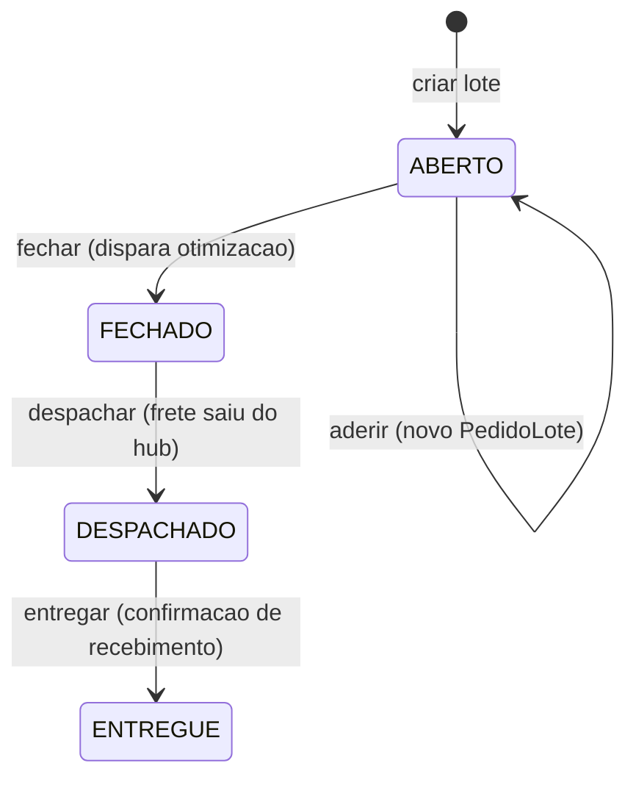
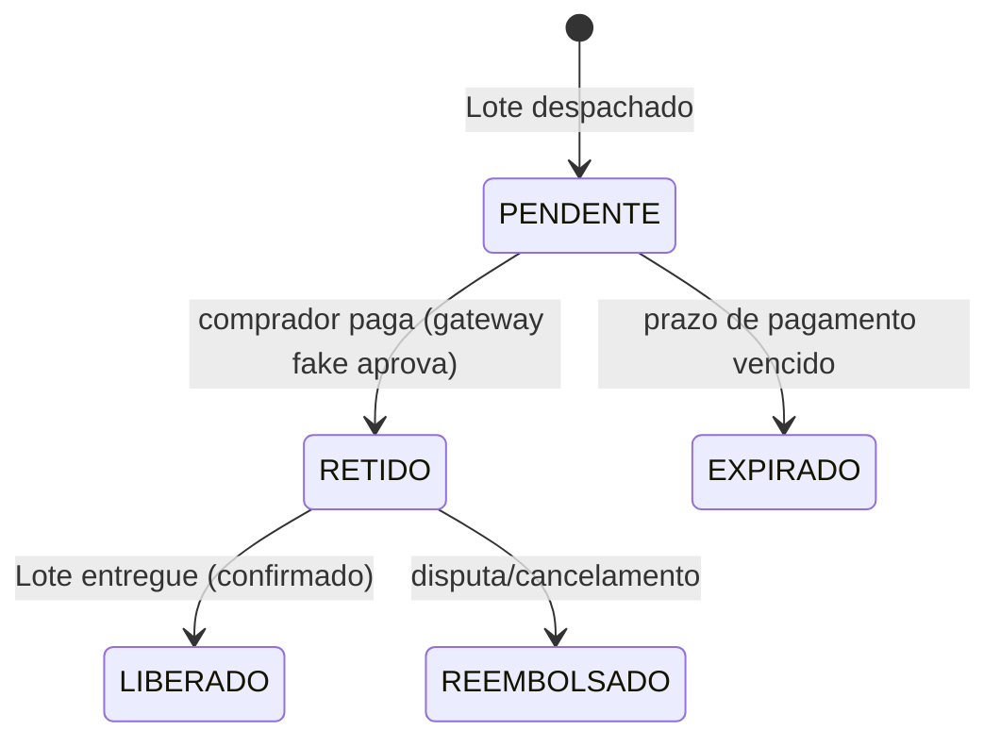

# Design do Backend (NestJS) — OE2 ↔ OE3

> Documento de design. **Nenhum código de aplicação foi escrito** — isto é a
> base para revisão antes de qualquer implementação. Onde uma decisão real
> precisa de uma resposta sua, está marcada **❓ DECISÃO EM ABERTO** com uma
> única pergunta, isolada das outras. Onde os artefatos já existentes
> (CLAUDE.md, schema.prisma, a migration de RLS) já respondem, uso a resposta
> deles e cito a fonte — não assumo nada que não esteja em algum lugar.
>
> Fontes lidas: `README.md`, `ESTRUTURA.md`, `CLAUDE.md`,
> `apps/backend/prisma/schema.prisma`,
> `apps/backend/prisma/migrations/20260925152119_enable_rls_.../migration.sql`,
> `apps/backend/package.json` (scaffold NestJS 12 puro, Prisma 6.19.3, sem
> auth/zod/fila instalados ainda).

---

## 0. Estado atual (ponto de partida real, não hipotético)

- Backend: `apps/backend/src/` só tem `AppModule`/`AppController`/`AppService`
  default do `nest new`. Nenhum módulo de domínio existe.
- Schema: 7 models (`Comprador`, `Fornecedor`, `Produto`, `HubLogistico`,
  `Lote`, `PedidoLote`, `Avaliacao`) + `enum StatusLote { ABERTO FECHADO
  DESPACHADO }`. **Não existe** model de autenticação, sessão/refresh token,
  pagamento, nem log de auditoria — todos esses são propostas novas neste
  documento, não extensões de algo que já existe.
- RLS: ativado em `Comprador`, `Lote`, `PedidoLote`, `Avaliacao`, role
  `app_comprador` (NOLOGIN, sem BYPASSRLS), identidade via
  `SET LOCAL app.comprador_id`. A migration já documenta duas pendências
  textualmente (breakdown agregado, e restrição por coluna em
  `PedidoLote`) — a seção 4 deste doc é a proposta de resolução delas.
- Contrato de API mínimo já definido em `CLAUDE.md` §6:
  `POST /lotes`, `POST /lotes/:id/aderir`, `GET /lotes/:id/breakdown`,
  `POST /lotes/:id/fechar`, `GET /fornecedores/:id/reputacao`,
  `POST /avaliacoes`, e o microsserviço `POST /optimize` (não exposto ao
  frontend). Este documento expande esse contrato, não o substitui.
- Stack já travada em `CLAUDE.md` §3: NestJS, Prisma, FastAPI+DEAP para o
  otimizador, RabbitMQ **ou** Celery para a fila (ainda não decidido qual —
  ver seção 7).

---

## 1. Módulos NestJS

### 1.1 Lista e responsabilidade

| Módulo | Responsabilidade | Depende de |
|---|---|---|
| `AuthModule` | Login, emissão/rotação/revogação de token, guards de papel | `IdentidadeModule` (ver Q1) |
| `CompradoresModule` | CRUD do próprio cadastro (`Comprador`) | `AuthModule` |
| `FornecedoresModule` | CRUD do próprio cadastro, consulta pública de catálogo | `AuthModule` |
| `ProdutosModule` | CRUD de produto (só o fornecedor dono) | `FornecedoresModule` |
| `HubsModule` | Leitura de `HubLogistico` (catálogo público, sem escrita via API — hubs são seed/admin) | — |
| `LotesModule` | Ciclo de vida do lote (`criar`, `aderir` delega a `PedidosModule`, `fechar`, `breakdown`, `despachar`, `entregar`) | `ProdutosModule`, `HubsModule`, `PedidosModule`, `RateioModule`, `OptimizerClientModule`, `AuditoriaModule` |
| `PedidosModule` | `PedidoLote` — adesão do comprador a um lote | `CompradoresModule`, `LotesModule` (referência circular leve — ver nota abaixo) |
| `RateioModule` | Cálculo proporcional de `costShare` no fechamento do lote (pura regra de negócio, sem endpoint HTTP próprio) | — (serviço puro, sem dependências de outros módulos de domínio) |
| `PagamentosModule` | Escrow simulado (ver seção 5.2 — model novo, Q5 em aberto) | `LotesModule`, `PedidosModule` |
| `AvaliacoesModule` | `POST /avaliacoes`, dispara análise de sentimento (OE4, hoje só a interface/stub — OE4 ainda não implementado) | `CompradoresModule`, `FornecedoresModule` |
| `ReputacaoModule` | `GET /fornecedores/:id/reputacao` — índice composto (sentimento + 4 métricas operacionais, CLAUDE.md §2 OE4) | `AvaliacoesModule`, `FornecedoresModule` |
| `OptimizerClientModule` | Publica na fila, consome resposta do microsserviço Python (seção 7) | — |
| `AuditoriaModule` | Log append-only (seção 6), consumido via interceptor por todos os módulos que mutam estado | — (nenhum módulo de domínio depende DELE no sentido de import — ele observa via interceptor global) |
| `PrismaModule` | `PrismaService` + o mecanismo de troca de identidade por request (seção 4.1) | — |

**Nota sobre `LotesModule` ↔ `PedidosModule`**: adesão (`POST
/lotes/:id/aderir`) cria um `PedidoLote`, então logicamente pertence aos
dois. Proposta: o endpoint fica em `LotesModule` (é a rota
`/lotes/:id/aderir`), mas a escrita do `PedidoLote` é delegada a
`PedidosService` (`PedidosModule`), evitando que `LotesModule` manipule
`PedidoLote` diretamente. `PedidosModule` não precisa importar `LotesModule`
de volta (só recebe o `loteId` já validado).

### 1.2 Grafo de dependências



### 1.3 ❓ DECISÃO EM ABERTO (Q-módulos)

**Pergunta:** você concorda com granularidade "um módulo por entidade +
alguns módulos de domínio puro (`RateioModule`, `OptimizerClientModule`,
`AuditoriaModule`)", ou prefere agrupar em domínios maiores — por exemplo um
único `ComprasModule` cobrindo `Lotes` + `Pedidos` + `Rateio` + `Pagamentos`?
A granularidade fina facilita achar código por entidade (bom para a banca
ler), mas gera mais boilerplate de módulo NestJS para um projeto solo.

---

## 2. Endpoints, DTOs (Zod), erros e paginação

### 2.1 Convenções gerais

**Envelope de erro** (uniforme em toda a API):

```ts
type ErroApi = {
  error: {
    code: string;       // catálogo fechado, ver 2.4
    message: string;    // texto humano, pt-BR
    details?: unknown;  // ex.: issues do Zod em erro de validação
  };
};
```

**Paginação**: proposta **offset/limit** (`?page=1&pageSize=20`), não cursor.
Justificativa: a escala de um TCC/protótipo não paga o custo de
implementar cursor corretamente (que exigiria cursor composto
`createdAt+id`, já que `cuid()` não é ordenável), e offset é o que o
comprador/fornecedor entende mais facilmente numa tela com "página 2, página
3" (relevante para OE3 — usabilidade). Resposta paginada:

```ts
type Paginado<T> = {
  items: T[];
  page: number;
  pageSize: number;
  total: number;
};
```

### 2.2 Endpoints por módulo

| Método | Rota | Papel exigido | Observação |
|---|---|---|---|
| `POST` | `/auth/login` | público | |
| `POST` | `/auth/refresh` | público (exige refresh token válido) | rotação — ver seção 3 |
| `POST` | `/auth/logout` | autenticado | revoga o refresh token atual |
| `GET` | `/compradores/me` | comprador | |
| `PATCH` | `/compradores/me` | comprador | |
| `GET` | `/fornecedores` | público | paginado, catálogo |
| `GET` | `/fornecedores/:id` | público | |
| `PATCH` | `/fornecedores/me` | fornecedor | |
| `GET` | `/fornecedores/:id/reputacao` | público | já no contrato (CLAUDE.md) |
| `POST` | `/produtos` | fornecedor | |
| `GET` | `/produtos` | público | paginado, filtrável por `fornecedorId` |
| `PATCH` | `/produtos/:id` | fornecedor (dono) | |
| `GET` | `/hubs` | público | catálogo, sem escrita via API |
| `POST` | `/lotes` | fornecedor ou admin — ❓ ver Q-criação-lote abaixo | já no contrato |
| `GET` | `/lotes` | público | paginado, filtrável por `status`/`hubId` |
| `GET` | `/lotes/:id` | público | |
| `POST` | `/lotes/:id/aderir` | comprador | já no contrato |
| `GET` | `/lotes/:id/breakdown` | comprador participante, ou admin | já no contrato — ver seção 4.3 |
| `POST` | `/lotes/:id/fechar` | admin ou automático (job) — ❓ ver abaixo | já no contrato, dispara fila |
| `POST` | `/lotes/:id/despachar` | admin | transição `FECHADO → DESPACHADO` |
| `POST` | `/lotes/:id/entregar` | admin ou fornecedor | transição `DESPACHADO → ENTREGUE` (estado novo, ver seção 5) |
| `POST` | `/avaliacoes` | comprador | já no contrato |
| `GET` | `/avaliacoes?fornecedorId=` | público | paginado |
| `GET` | `/lotes/:id/pagamento` | comprador participante, ou admin | model novo, ver seção 5.2 |
| `GET` | `/auditoria?entidade=&entidadeId=` | admin | seção 6 |

**❓ DECISÃO EM ABERTO (Q-criação-lote):** quem pode chamar `POST /lotes` —
um fornecedor (oferecendo um produto para compra coletiva) ou só um admin
curando o catálogo? O contrato em CLAUDE.md não diz. Isso muda o guard do
endpoint e se `Produto.fornecedorId` precisa bater com o `fornecedorId` do
token.

**❓ DECISÃO EM ABERTO (Q-fechamento-lote):** `POST /lotes/:id/fechar` é
chamado manualmente por um admin, ou deveria ser automático (um job
agendado que verifica `LIMIAR_TEMPORAL_DIAS`/capacidade, como as baselines
do experimento OE1)? Isso afeta se existe um `SchedulerModule` adicional.

### 2.3 DTOs Zod — exemplos representativos

```ts
// lotes/dto/criar-lote.dto.ts
export const CriarLoteSchema = z.object({
  produtoId: z.string().cuid(),
  hubId: z.string().cuid(),
});
export type CriarLoteDto = z.infer<typeof CriarLoteSchema>;

// lotes/dto/aderir-lote.dto.ts
export const AderirLoteSchema = z.object({
  volumeM3: z.number().positive(),
  // costShare NAO existe aqui de proposito -- ver secao 4.4 (Q4):
  // o comprador declara so o volume, nunca o valor que vai pagar.
});

// lotes/dto/breakdown-response.dto.ts
export const BreakdownResponseSchema = z.object({
  loteId: z.string().cuid(),
  status: z.nativeEnum(StatusLote),
  hub: z.object({ nome: z.string(), custoFixoDespacho: z.number() }),
  volumeTotalM3: z.number(),
  custoTotal: z.number().nullable(),
  participantes: z.array(
    z.object({
      compradorId: z.string().cuid(),
      // nome do comprador SO aparece se for o proprio comprador olhando o
      // proprio breakdown, ou admin -- ver secao 4.3
      volumeM3: z.number(),
      percentualDoLote: z.number(), // volumeM3 / volumeTotalM3 -- é a conta que o OE3 pede pro comprador reproduzir
      costShare: z.number().nullable(),
    }),
  ),
});
```

### 2.4 Catálogo de códigos de erro (fechado, não string livre)

| Code | HTTP | Significado |
|---|---|---|
| `VALIDACAO` | 400 | payload não passou no schema Zod (`details` = issues) |
| `NAO_AUTENTICADO` | 401 | token ausente ou inválido |
| `TOKEN_EXPIRADO` | 401 | access token expirado — cliente deve chamar `/auth/refresh` |
| `REFRESH_TOKEN_INVALIDO` | 401 | refresh token revogado, reutilizado após rotação, ou expirado |
| `SEM_PERMISSAO` | 403 | papel correto, mas não é o dono do recurso |
| `RECURSO_NAO_ENCONTRADO` | 404 | id não existe (ou RLS devolveu vazio — ver nota abaixo) |
| `LOTE_JA_FECHADO` | 409 | tentativa de aderir/editar um lote fora do estado `ABERTO` |
| `CAPACIDADE_EXCEDIDA` | 409 | volume do pedido ultrapassa capacidade restante do hub |
| `COMPRADOR_JA_ADERIU` | 409 | violação do `@@unique([loteId, compradorId])` |
| `TRANSICAO_INVALIDA` | 409 | transição de estado fora da máquina (seção 5) |
| `OTIMIZADOR_INDISPONIVEL` | 503 | timeout/erro ao chamar o microsserviço (seção 7) |

**Nota sobre `RECURSO_NAO_ENCONTRADO` vs RLS**: como o RLS filtra linhas no
nível do Postgres, uma tentativa de acessar o `PedidoLote` de OUTRO
comprador retorna "não encontrado" (porque a linha literalmente não aparece
pro role `app_comprador` daquela sessão) — nunca `SEM_PERMISSAO`. Isso é
intencional (não revela que o recurso existe), mas é importante documentar
porque é diferente do caso de autorização "normal" em nível de aplicação.

---

## 3. Autenticação e papéis

### 3.1 ❓ DECISÃO EM ABERTO (Q1 — modelo de identidade)

Hoje `Comprador` e `Fornecedor` **não têm** `passwordHash` nem nenhum campo
de credencial, e **não existe** entidade `Administrador` no schema. Preciso
de uma resposta antes de desenhar o `AuthModule`, porque isso muda o shape
do JWT e das tabelas:

**Opção A** — `passwordHash` + `role` diretamente em `Comprador` e
`Fornecedor` (cada um autentica como si mesmo), e um terceiro model
`Administrador` separado para o papel admin.

**Opção B** — um model `Usuario` central (`email`, `passwordHash`, `role:
COMPRADOR|FORNECEDOR|ADMIN`) com FK opcional para `compradorId` ou
`fornecedorId` dependendo do papel — `Comprador`/`Fornecedor` continuam sem
credencial própria, só dados de negócio.

Opção B separa autenticação de identidade de negócio (mais alinhado com
"multi-ator" do OE2), mas exige migrar `Comprador.email`/`Fornecedor` (hoje
únicos ali) para o novo model. Qual você quer?

### 3.2 Fluxo de login/refresh/revogação (assumindo Q1 resolvida)



- **Access token (JWT)**: vida curta. `JWT_EXPIRES_IN` já está definido como
  `15m` em `.env.example` (raiz do repo) — reaproveito esse valor, não
  invento um novo.
- **Refresh token**: vida longa, `JWT_REFRESH_EXPIRES_IN="7d"` (mesmo
  arquivo). Rotação em cadeia (cada uso invalida o anterior e emite o
  próximo) com **detecção de reuso**: se um refresh token já consumido for
  apresentado de novo, é sinal de token roubado — revoga a família inteira,
  força novo login.
- Claims do JWT: `sub` (id do usuário/ator — depende de Q1), `role`, e
  **não** inclui `compradorId` cru sem o prefixo de papel — ver 3.3.

### 3.3 Guards e papéis

Três papéis: `comprador`, `fornecedor`, `admin`. Proposta de decorator:

```ts
@Roles('comprador')
@UseGuards(JwtAuthGuard, RolesGuard)
@Post('lotes/:id/aderir')
aderir(@Principal() principal: PrincipalAutenticado, ...) { ... }
```

`RolesGuard` rejeita com `SEM_PERMISSAO` (403) se o papel não bate — isso é
auxiliar/defesa em profundidade; a garantia real de isolamento por dado é o
RLS (seção 4), não o guard. Um bug no guard não deveria conseguir vazar dado
de outro comprador, porque o Postgres já filtra antes disso.

### 3.4 ❓ DECISÃO EM ABERTO (Q2 — onde persistir refresh tokens)

Para rotação + revogação funcionarem, preciso guardar estado por sessão
(qual token é o atual da família, se foi revogado). Três opções:

**A.** Tabela Prisma nova (`SessaoRefreshToken`: id, usuarioId, hashToken,
familiaId, usedAt, revokedAt, expiresAt) — fica no Postgres, transacional,
mas é mais uma tabela sob RLS pra pensar (provavelmente só acessível pelo
role de serviço, nunca por `app_comprador` diretamente).

**B.** Redis (TTL nativo, revogação é só um `DEL`) — mais rápido, mas é uma
peça de infraestrutura nova que `docker-compose.yml` ainda não tem.

**C.** JWT stateless com deny-list curta (só guarda tokens *revogados*
antes de expirar, não cada sessão ativa) — menos escrita, mas não dá pra
"ver sessões ativas" como feature futura.

Qual prefere? (Reflete também se vale a pena já colocar Redis no
`docker-compose.yml` nesta fase do TCC.)

---

## 4. Ponte com o RLS

Contexto já documentado na migration (`20260925152119_...`): o Postgres tem
`app_comprador` (NOLOGIN, NOSUPERUSER, NOBYPASSRLS) com políticas que
comparam contra `current_setting('app.comprador_id', true)`. A migration já
deixa escrito que isso **ainda não está conectado a nada** — esta seção é
essa conexão.

### 4.1 Troca de identidade por request

Proposta: um `interceptor`/`middleware` do Nest, de escopo *por request*,
que abre explicitamente uma transação Prisma e, dentro dela, executa:

```sql
SET LOCAL ROLE app_comprador;
SET LOCAL app.comprador_id = '<id do comprador do JWT>';
```

antes de qualquer query da request, e deixa a transação commitar/fazer
rollback no fim do ciclo da request. Na prática, em Prisma isso significa
que **toda a camada de serviço que atua "como o comprador logado" precisa
rodar dentro de `prisma.$transaction(async (tx) => { ... })`** usando esse
`tx` — não o client Prisma módulo-level direto. Isso é uma restrição real
de como os services vão ser escritos (não é só um detalhe de infra): todo
`Service` de módulo que lê/escreve tabela com RLS recebe um `tx` injetado
pelo interceptor via `REQUEST`-scoped provider, não o `PrismaService` cru.

Para requests sem comprador autenticado (rotas públicas, ex.: `GET
/fornecedores`), a transação ainda roda como `app_comprador` mas sem `SET
LOCAL app.comprador_id` — as políticas de `Lote`/`Comprador`/`PedidoLote`
simplesmente retornam vazio para essas tabelas (fail-closed, documentado na
migration), o que está certo porque rotas públicas só tocam tabelas sem RLS
(`Fornecedor`, `Produto`, `HubLogistico`).

### 4.2 Role de serviço (admin/agregações)

Para rotinas que **precisam** ver todas as linhas (o job de reputação
agregando `Avaliacao` de todos os compradores; um admin chamando
`/lotes/:id/fechar`) — proposta: um segundo role Postgres, `app_service`,
com `BYPASSRLS`, usado **só** por esse conjunto restrito de rotinas, nunca
pelo caminho normal de request de um comprador/fornecedor. Isso é uma
migration nova (não escrita ainda — fora do escopo deste doc, que é só
design), análoga à de `app_comprador`.

### 4.3 ❓ DECISÃO EM ABERTO (Q3 — breakdown agregado)

A migration já identifica o problema: `GET /lotes/:id/breakdown` precisa do
rateio de TODOS os participantes do lote, não só do comprador logado — e a
política atual de `PedidoLote` restringe exatamente a isso. Duas opções,
ambas tecnicamente viáveis:

**A.** Função Postgres `SECURITY DEFINER` (`fn_breakdown_lote(lote_id)`) que
roda com os privilégios de quem a criou (ignora RLS do chamador),
retornando só as colunas do breakdown — chamada via
`prisma.$queryRaw`. Mantém a regra de "quem pode ver o quê" dentro do
Postgres (mais alinhado com "RLS é a fonte da verdade"), mas mistura lógica
de negócio em SQL.

**B.** `LotesService.breakdown()` chama o `app_service` (BYPASSRLS, seção
4.2) em vez do `app_comprador` da request — e a checagem "este comprador
pode ver este breakdown" (ele é participante, ou é admin) vira uma
verificação explícita no TypeScript antes de usar o role de serviço.

A opção B é mais simples de implementar e testar (lógica em TS, não em
SQL), mas depende de nunca esquecer essa checagem manual em algum lugar —
exatamente o tipo de erro que RLS existe pra prevenir estruturalmente.
Qual prefere?

### 4.4 ❓ DECISÃO EM ABERTO (Q4 — restrição por coluna em `PedidoLote`)

Também já identificado na migration: a política `pedidolote_own_insert`
restringe a LINHA (`compradorId` = o próprio), mas não a COLUNA — nada
impede hoje que, via `app_comprador`, alguém insira um `PedidoLote` já com
`costShare` preenchido (que deveria ser calculado só no fechamento do
lote). Três opções:

**A.** Validação só na camada de serviço NestJS: o DTO de adesão
(`AderirLoteSchema`, seção 2.3) nem aceita `costShare` como campo — confia
que todo acesso à tabela passa pela API, nunca direto no banco.

**B.** `REVOKE UPDATE (costShare) ON PedidoLote FROM app_comprador` +
`GRANT UPDATE (volumeM3) ...` — column-level privilege real no Postgres,
sobrevive mesmo que alguém rode SQL direto (ex.: um bug em outro endpoint).

**C.** Uma view de inserção (`PedidoLoteAdesao`, só com `loteId`,
`compradorId`, `volumeM3`) com `INSTEAD OF INSERT` escrevendo na tabela
real — o comprador literalmente não tem acesso de escrita à coluna
`costShare` em nenhum nível.

B é o mais forte (defesa no nível certo, igual o RLS) e mais barato que C.
A é o mais simples, mas é só disciplina de código, não garantia estrutural
— é exatamente o tipo de coisa que, numa tese sobre transparência
financeira auditável (OE2/OE3), vale a pena fazer "certo". Minha
inclinação é B; você concorda, ou prefere A pela simplicidade?

---

## 5. Máquinas de estado

### 5.1 Lote

Schema atual (`enum StatusLote`) só tem `ABERTO | FECHADO | DESPACHADO`.
Esta tarefa pediu uma máquina com 4 estados incluindo `ENTREGUE` — **isso é
uma mudança de schema que ainda não existe**, proposta aqui, não aplicada:



| De | Para | Gatilho | Efeito colateral |
|---|---|---|---|
| — | `ABERTO` | `POST /lotes` | |
| `ABERTO` | `FECHADO` | `POST /lotes/:id/fechar` | publica na fila do otimizador (seção 7); `RateioModule` calcula `costShare` de cada `PedidoLote` dentro da MESMA transação (ACID, exigência OE2) |
| `FECHADO` | `DESPACHADO` | `POST /lotes/:id/despachar` | seta `dispatchDate`; cria registro(s) de `Pagamento` em escrow (seção 5.2) |
| `DESPACHADO` | `ENTREGUE` | `POST /lotes/:id/entregar` | libera o escrow (ver 5.2); dispara oportunidade de `Avaliacao` |
| qualquer | mesmo estado | tentativa de transição inválida | `TRANSICAO_INVALIDA` (409) |

Toda transição que toca `PedidoLote`/`costShare`/`Pagamento` precisa ser
uma única transação Prisma (`$transaction`) — é literalmente o critério de
sucesso do OE2 ("tolerância zero a inconsistência").

### 5.2 Pagamento (escrow simulado) — ❓ DECISÃO EM ABERTO (Q5)

**Não existe model de pagamento no schema hoje.** "Escrow simulado: gateway
fake, fluxo real" significa (entendimento meu, a confirmar): o dinheiro não
se move de verdade, mas o ESTADO passa pelas mesmas transições que um
escrow real passaria, com um adapter de gateway fake (sempre aprova, com
delay simulável) por trás da mesma interface que um gateway real usaria.

Antes de desenhar os estados, preciso de uma resposta estrutural:

**O escrow é por `PedidoLote` (cada comprador trava e libera sua própria
fração do pagamento, independentemente dos outros) ou por `Lote` (um
pagamento agregado só é liberado ao fornecedor quando TODOS os compradores
daquele lote pagaram)?**

Isso muda tudo: no primeiro caso, `Pagamento` tem FK para `PedidoLote` e a
máquina de estado é independente por comprador; no segundo, `Pagamento` tem
FK para `Lote`, soma várias contribuições, e precisa de um estado
intermediário ("aguardando os outros compradores") que não existe se for
por `PedidoLote`. Proposta de estados assumindo a primeira leitura (por
`PedidoLote`, que é a que mais se alinha ao rateio já ser por participante):



Qual das duas leituras é a certa?

---

## 6. Log de auditoria imutável

**Model novo** (não existe hoje):

```prisma
model LogAuditoria {
  id              String   @id @default(cuid())
  entidade        String   // "Lote" | "PedidoLote" | "Pagamento" | "Avaliacao" ...
  entidadeId      String
  acao            String   // "CRIAR" | "FECHAR" | "DESPACHAR" | ...
  atorId          String?  // quem fez a acao (null = job automatico/sistema)
  versaoAlgoritmo String?  // hash/tag do otimizador, quando a acao envolve o AG (seção 7)
  hashEntrada     String?  // sha256 do payload de entrada, para acoes que chamam o otimizador
  dadosDepois     Json     // snapshot do estado apos a acao
  createdAt       DateTime @default(now())
}
```

**Append-only de verdade**: `REVOKE UPDATE, DELETE ON "LogAuditoria" FROM
app_comprador, app_service` (só o role de migração/superuser mantém esses
privilégios, e nunca é usado em runtime) — garante no nível do Postgres, não
só por convenção de código, que ninguém apaga ou edita um registro depois
de escrito.

Gravação via interceptor NestJS global (não espalhado manualmente em cada
service) — escuta o fim de cada request que mutou estado em um módulo
auditável e grava a linha na mesma transação da mutação.

### ❓ DECISÃO EM ABERTO (Q-auditoria-escopo)

**O que exatamente entra no log**: todas as mutações (CRUD completo de
todos os módulos) ou só as "sensíveis" (fechar/despachar/entregar lote,
pagamento, avaliação)? Logar tudo é mais simples de implementar (um
interceptor genérico) mas gera muito volume para pouco valor de auditoria
(ex.: um fornecedor editando a descrição de um produto não parece algo que
precise de trilha imutável). Minha inclinação é "sensíveis" — mas qual é a
lista exata que você quer na trilha?

---

## 7. Contrato com o otimizador (FastAPI + fila)

CLAUDE.md já define `POST /optimize` no microsserviço e deixa a fila como
"RabbitMQ ou Celery" (não decidido qual). Proposta de schemas (reaproveitando
o modelo de custo já validado em `services/optimizer/` — ver `custo.py`,
`parametros.py`):

```ts
// Mensagem publicada na fila por LotesService.fechar()
type OtimizarRequest = {
  idempotencyKey: string;       // = loteId + versao da tentativa, evita reprocessar 2x
  loteId: string;
  pedidos: Array<{
    pedidoLoteId: string;
    volumeM3: number;
    pesoKg: number;
    diaChegada: number;
  }>;
  hub: { id: string; distanciaKm: number; custoFixoDespacho: number; capacidadeM3: number };
  periodo: 'cheia' | 'seca';
  versaoAlgoritmo: string;      // tag do modulo services/optimizer no momento da chamada
};

// Resposta consumida de volta pela fila
type OtimizarResponse = {
  idempotencyKey: string;
  loteId: string;
  custoTotal: number;
  modalEscolhido: 'rodoviario' | 'fluvial' | 'aereo';
  rateioPorPedido: Array<{ pedidoLoteId: string; costShare: number }>;
  geracoesConvergencia: number;
};
```

- **Idempotência**: `idempotencyKey` é verificada pelo backend antes de
  aplicar o resultado — se a mesma chave já foi processada (reentrega da
  fila, retry), a resposta é descartada silenciosamente em vez de rodar o
  rateio duas vezes.
- **Timeout**: se o microsserviço não responder em um prazo configurável, o
  backend marca a tentativa como falha (`OTIMIZADOR_INDISPONIVEL`) e o lote
  **permanece em `ABERTO`** (não avança para `FECHADO` sem resultado) — evita
  o lote ficar "fechado" sem rateio calculado.
- **Versionamento do algoritmo**: `versaoAlgoritmo` grava no
  `LogAuditoria.versaoAlgoritmo` (seção 6) qual versão do código em
  `services/optimizer/` gerou aquele rateio — relevante porque o próprio
  histórico do OE1 já tem 3 versões (v1/v2/v3) com resultados diferentes.

### ❓ DECISÃO EM ABERTO (Q-fila)

CLAUDE.md deixa "RabbitMQ **ou** Celery" em aberto — são coisas diferentes
(RabbitMQ é o broker; Celery é um framework de task queue que PODE usar
RabbitMQ como broker, ou poderia ser substituído por algo mais simples do
lado Node, como BullMQ sobre Redis). Qual você quer: RabbitMQ consumido
diretamente (um consumer Python simples do lado do FastAPI, e
`@golevelup/nestjs-rabbitmq` ou similar do lado Nest), ou Celery (que
tipicamente pede Redis/RabbitMQ como backend de qualquer forma, mas dá
retry/agendamento prontos)?

---

## 8. Tempo real e rate limiting

### ❓ DECISÃO EM ABERTO (Q6 — SSE ou WebSocket)

Caso de uso: o comprador vendo o status de um lote mudar (`ABERTO →
FECHADO → DESPACHADO → ENTREGUE`) sem recarregar a página — relevante para
OE3 (usabilidade em conexão lenta amazônica, já citado no README/CLAUDE.md).

- **SSE**: unidirecional (servidor→cliente), HTTP puro (sem upgrade de
  protocolo), reconecta sozinho no browser, mais barato de operar e mais
  tolerante a conexão instável/lenta — mas não serve se algum dia precisar
  de canal bidirecional.
- **WebSocket**: bidirecional, mais "pesado" para estabelecer e manter
  (relevante justamente no cenário de conexão ruim que o TCC quer atender),
  exige infra de socket (Nest tem suporte nativo via `@nestjs/websockets`,
  mas em serverless/Vercel é mais fricção).

Dado que o caso de uso descrito é só "status mudou, atualiza a tela" (nunca
o cliente precisa enviar algo pelo mesmo canal), e o contexto é
explicitamente conexão lenta/instável — **minha inclinação é SSE**, mas
quero sua confirmação antes de desenhar o módulo em torno disso, porque
muda a escolha de hosting (CLAUDE.md cita Vercel, que tem restrições
conhecidas para conexões long-lived).

### ❓ DECISÃO EM ABERTO (Q7 — rate limiting)

Preciso de limites concretos, não só "ter rate limiting":

- Por IP, por usuário autenticado, ou os dois (IP para rotas públicas/login,
  usuário para rotas autenticadas)?
- Algum endpoint precisa de limite mais agressivo que os demais — chute
  razoável seria `POST /auth/login` (força bruta) e `POST
  /lotes/:id/aderir` (evitar um comprador martelando adesão) — mas quais
  números (requests/minuto)? Não vou inventar um número sem você confirmar
  que faz sentido pro cenário de uso real (poucos compradores simultâneos,
  provavelmente).

---

## 9. Plano de testes por módulo

| Módulo | Unitário | Integração | E2E |
|---|---|---|---|
| `RateioModule` | cálculo proporcional (casos: divisão exata, resto, volume zero, lote com 1 participante) — é a lógica mais crítica de auditabilidade (OE3), merece a maior cobertura unitária do projeto | transação completa de fechamento contra Postgres real (testcontainers ou banco de teste dedicado) verificando ACID (rollback em erro parcial) | `POST /lotes/:id/fechar` → `GET /breakdown` reproduz a conta |
| `AuthModule` | geração/validação de JWT, detecção de reuso de refresh token | rotação completa contra a tabela de sessão (Q2) | login → refresh → logout → token antigo rejeitado |
| RLS (`PrismaModule`/interceptor) | — (não dá para testar RLS sem banco real) | **o mais importante**: mesmo teste de isolamento já escrito em `apps/backend/prisma/tests/rls-isolation.sql`, mas agora chamado a partir do `PrismaService`/interceptor do Nest, não só via `psql` direto — comprador A nunca vê linha de B através da API | tentativa de acessar `PedidoLote`/`Avaliacao` de outro comprador via HTTP retorna 404, nunca 200 com dado vazado |
| `LotesModule` | transições de estado válidas/inválidas (tabela da seção 5.1) | criação → adesão → fechamento, capacidade excedida | ciclo completo `ABERTO → ENTREGUE` |
| `PagamentosModule` | máquina de estado do escrow (depende de Q5) | gateway fake com delay simulado | — |
| `OptimizerClientModule` | serialização do `OtimizarRequest`/`OtimizarResponse` | idempotência (reentrega da mesma `idempotencyKey` não duplica rateio), timeout → `OTIMIZADOR_INDISPONIVEL` | mock do microsserviço (não chama o Python real no E2E do backend) |
| `AuditoriaModule` | nunca permite `UPDATE`/`DELETE` (teste que tenta e espera erro do Postgres) | interceptor grava exatamente 1 linha por mutação auditável | — |
| `ReputacaoModule` | cálculo do índice composto (depende do OE4, ainda não implementado — fica como teste pendente/skip documentado) | — | — |

Ferramental: `jest` (já no `package.json`) para unit/integração,
`supertest` (já presente) para E2E — nenhuma dependência nova precisa ser
decidida aqui, diferente dos pontos anteriores.

---

## Checklist — decisões em aberto (uma pergunta por item, nenhuma assumida)

1. **Granularidade de módulos** — manter 1 módulo por entidade + módulos de
   domínio puro, ou agrupar em domínios maiores? (seção 1.3)
2. **Quem pode criar um lote** — fornecedor ou só admin? (seção 2.2)
3. **Fechamento de lote** — manual (admin) ou automático (job agendado)?
   (seção 2.2)
4. **Modelo de identidade (Q1)** — `passwordHash` direto em
   `Comprador`/`Fornecedor` + model `Administrador` separado, ou um
   `Usuario` central com FK opcional? (seção 3.1)
5. **Onde persistir refresh tokens (Q2)** — tabela Prisma, Redis, ou
   deny-list stateless? (seção 3.4)
6. **Breakdown agregado (Q3)** — função `SECURITY DEFINER` em SQL, ou
   `app_service` chamado a partir do TypeScript com checagem manual? (seção
   4.3)
7. **Restrição por coluna em `PedidoLote` (Q4)** — confiar na validação do
   DTO, usar `REVOKE`/`GRANT` por coluna, ou uma view de inserção? (seção
   4.4)
8. **Escrow por `PedidoLote` ou por `Lote` (Q5)** — decisão estrutural antes
   de desenhar os estados do pagamento (seção 5.2)
9. **Escopo do log de auditoria** — todas as mutações ou só as sensíveis?
   Qual é a lista exata, se for a segunda opção? (seção 6)
10. **RabbitMQ ou Celery** — e, se RabbitMQ, qual lib do lado NestJS?
    (seção 7)
11. **SSE ou WebSocket** para status em tempo real do lote? (seção 8 —
    minha inclinação é SSE, dado o cenário de conexão lenta, mas não
    assumi)
12. **Limites concretos de rate limiting** — por IP, por usuário, ou os
    dois; quais números para login e adesão a lote? (seção 8)
