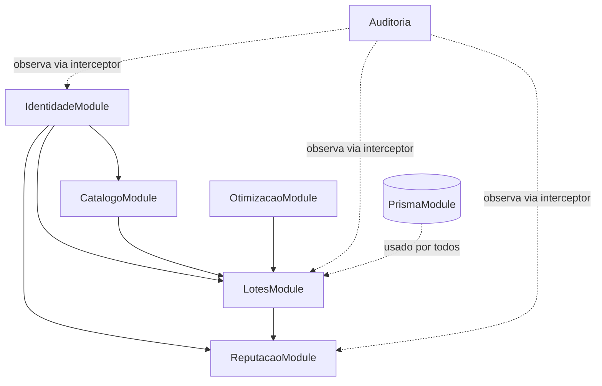
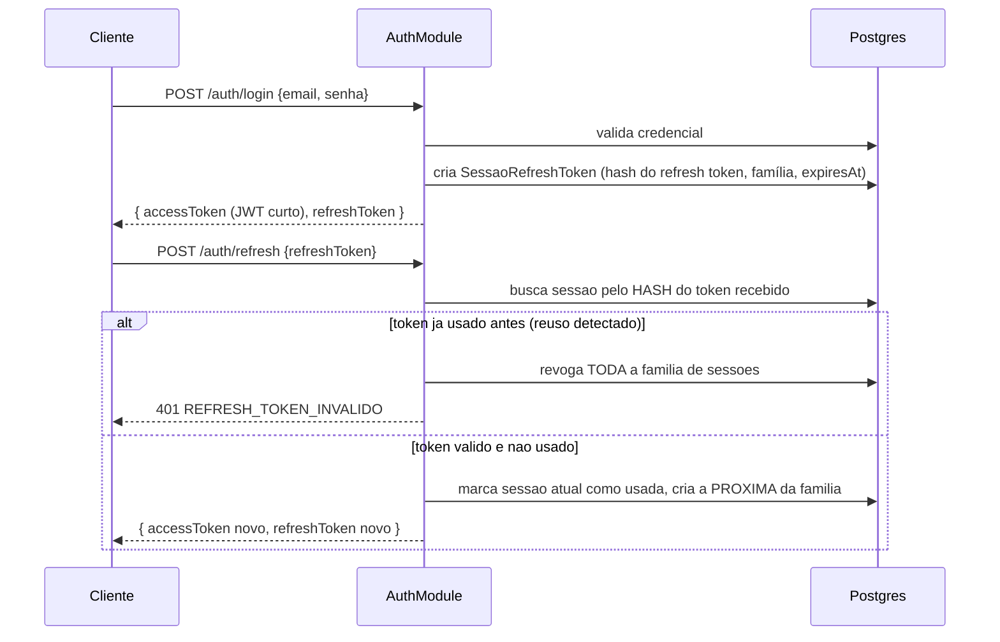
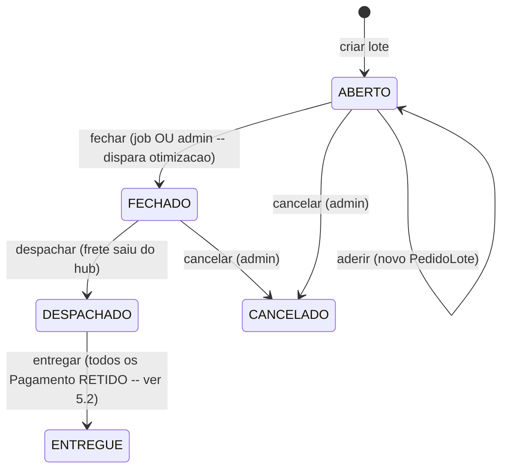
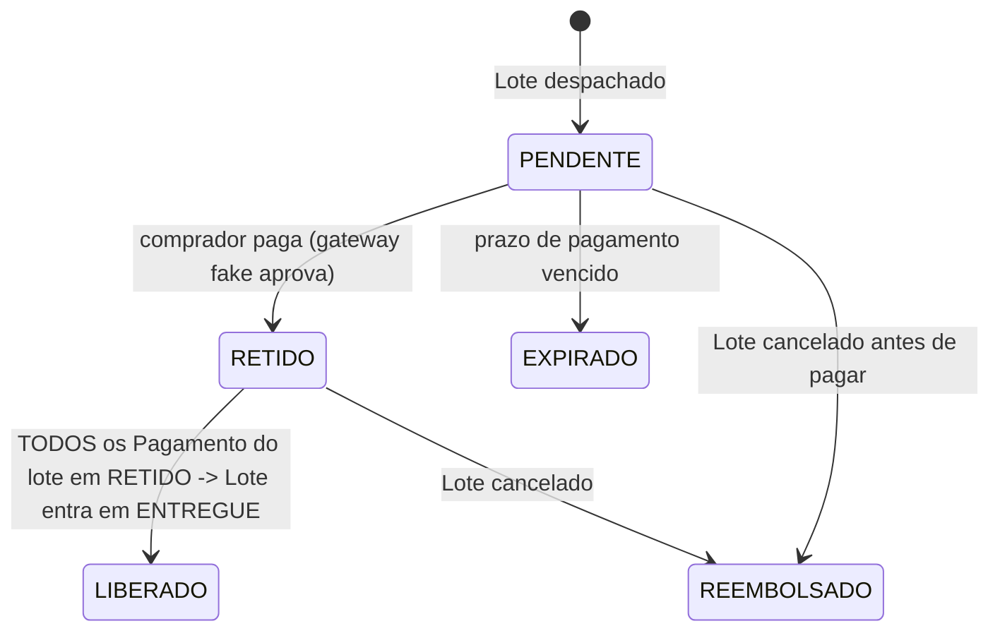

# Design do Backend (NestJS) — OE2 ↔ OE3

> Documento de design. **Nenhum código de aplicação foi escrito** — isto é a
> base para revisão antes de qualquer implementação. A primeira versão
> deste documento levantou 12 decisões em aberto, uma pergunta por vez, sem
> assumir resposta; todas foram respondidas — ver **"Decisões aprovadas"**
> abaixo. Três delas (🔶, marcadas também nas seções 2, 5) são decisões de
> produto, não técnicas, e ficam pendentes de validação do orientador antes
> de implementar. Onde os artefatos já existentes (CLAUDE.md, schema.prisma,
> a migration de RLS) já respondiam, usei a resposta deles e citei a fonte —
> não assumi nada que não estivesse em algum lugar.
>
> Fontes lidas: `README.md`, `ESTRUTURA.md`, `CLAUDE.md`,
> `apps/backend/prisma/schema.prisma`,
> `apps/backend/prisma/migrations/20260925152119_enable_rls_.../migration.sql`,
> `apps/backend/package.json` (scaffold NestJS 12 puro, Prisma 6.19.3, sem
> auth/zod/fila instalados ainda).

---

## 0. Estado atual (ponto de partida real, não hipotético)

- Backend: `apps/backend/src/` só tem `AppModule`/`AppController`/`AppService`
  default do `nest new`. Nenhum módulo de domínio existe.
- Schema: 7 models (`Comprador`, `Fornecedor`, `Produto`, `HubLogistico`,
  `Lote`, `PedidoLote`, `Avaliacao`) + `enum StatusLote { ABERTO FECHADO
  DESPACHADO }`. **Não existe** model de autenticação, sessão/refresh token,
  pagamento, nem log de auditoria — todos esses são propostas novas neste
  documento, não extensões de algo que já existe.
- RLS: ativado em `Comprador`, `Lote`, `PedidoLote`, `Avaliacao`, role
  `app_comprador` (NOLOGIN, sem BYPASSRLS), identidade via
  `SET LOCAL app.comprador_id`. A migration já documenta duas pendências
  textualmente (breakdown agregado, e restrição por coluna em
  `PedidoLote`) — a seção 4 deste doc é a proposta de resolução delas.
- Contrato de API mínimo já definido em `CLAUDE.md` §6:
  `POST /lotes`, `POST /lotes/:id/aderir`, `GET /lotes/:id/breakdown`,
  `POST /lotes/:id/fechar`, `GET /fornecedores/:id/reputacao`,
  `POST /avaliacoes`, e o microsserviço `POST /optimize` (não exposto ao
  frontend). Este documento expande esse contrato, não o substitui.
- Stack já travada em `CLAUDE.md` §3: NestJS, Prisma, FastAPI+DEAP para o
  otimizador, RabbitMQ **ou** Celery para a fila (ainda não decidido qual —
  ver seção 7).

---

## Decisões aprovadas

Todas as 12 perguntas da primeira versão deste documento foram respondidas.
Esta seção resume cada resposta e aponta para a seção detalhada atualizada.
**Três delas (marcadas 🔶) são decisões de produto, não técnicas — ficam
sinalizadas como pendentes de validação do orientador antes de implementar,
mesmo já aprovadas por você.**

| # | Decisão | Resposta aprovada | Seção |
|---|---|---|---|
| 1 | Granularidade de módulos | 6 módulos por domínio: Identidade, Catálogo, Lotes, Reputação, Auditoria, Otimização | 1 |
| 2 🔶 | Quem cria/cancela lote | Fornecedor abre lote só dos próprios produtos; admin abre/cancela qualquer um; parâmetros de custo vêm da plataforma, nunca do payload | 2.2, 5.1 |
| 3 🔶 | Fechamento de lote | Automático (job + gatilho por limiar) com override manual do admin | 2.2, 5.1 |
| 4 | Modelo de identidade | Tabela `Usuario` (argon2id), papel `COMPRADOR\|FORNECEDOR\|ADMIN`, 1:1 com `Comprador`/`Fornecedor`; admin sem perfil; JWT leva papel + `perfilId` | 3.1 |
| 5 | Onde persistir refresh token | Tabela Prisma: hash, família, detecção de reuso, job de limpeza periódica | 3.4 |
| 6 | Breakdown agregado | Função `SECURITY DEFINER` (search_path fixo, `EXECUTE` só para `app_comprador`) retornando totais + linha própria + volumes anônimos dos demais | 4.3 |
| 7 | Restrição por coluna em `PedidoLote` | `GRANT INSERT` por coluna (sem `costShare`) + Zod no DTO como segunda camada; `costShare` nullable, preenchido pelo backend no fechamento | 4.4 |
| 8 🔶 | Modelagem do pagamento | `Pagamento` por `PedidoLote`; estado agregado verificado no `Lote`; `Repasse` por `Lote` (ao fornecedor); enum de estados do lote ampliado | 5 |
| 9 | Escopo da auditoria | Toda escrita financeira e de lotes + eventos de auth; append-only via `REVOKE` + trigger, hash encadeado, advisory lock | 6 |
| 10 | Fila | RabbitMQ + consumidor `aio-pika` no lado Python; idempotência, DLQ, retry; FastAPI mantém os endpoints REST (inclusive para teste manual via curl, como já pedia o CLAUDE.md) | 7 |
| 11 | Tempo real | SSE, autenticado via cookie `httpOnly`, conectado direto no NestJS (sem gateway separado) | 8 |
| 12 | Rate limiting | Limites numéricos fechados — ver tabela na seção 8 | 8 |

---

## 1. Módulos NestJS

### 1.1 Lista e responsabilidade — 6 módulos por domínio (decisão aprovada)

Cada módulo é um domínio, não uma entidade — vários models Prisma podem
viver dentro do mesmo módulo quando fazem parte do mesmo ciclo de vida de
negócio (ex.: `Lote` + `PedidoLote` + `Pagamento` + `Repasse` são todos
estados do mesmo fluxo de compra, não domínios separados).

| Módulo | Entidades/responsabilidade | Depende de |
|---|---|---|
| `IdentidadeModule` | `Usuario` (credencial, seção 3.1), `Comprador`, `Fornecedor`, login/refresh/revogação, guards de papel, CRUD do próprio perfil | `PrismaModule` |
| `CatalogoModule` | `Produto`, `HubLogistico` — leitura pública (navegação pré-adesão) e escrita restrita ao fornecedor dono do produto | `IdentidadeModule` (para saber quem é o fornecedor dono) |
| `LotesModule` | `Lote`, `PedidoLote` (adesão), `Rateio` (serviço interno, sem endpoint próprio), `Pagamento`, `Repasse` — todo o ciclo de vida financeiro de uma compra coletiva, de `ABERTO` a `ENTREGUE`/`CANCELADO` (seção 5) | `CatalogoModule`, `IdentidadeModule`, `OtimizacaoModule`, `AuditoriaModule` |
| `ReputacaoModule` | `Avaliacao` (`POST /avaliacoes`) + cálculo do índice composto (`GET /fornecedores/:id/reputacao`, OE4) | `IdentidadeModule` |
| `AuditoriaModule` | `LogAuditoria` append-only (seção 6), observa via interceptor global | — (nenhum módulo importa dele; ele observa de fora) |
| `OtimizacaoModule` | Publica na fila RabbitMQ, consome a resposta do microsserviço Python (seção 7) | — |
| `PrismaModule` | `PrismaService` + troca de identidade por request (seção 4.1) | — |

Isso substitui a lista de 14 módulos finos da primeira versão deste
documento — `RateioModule`/`PagamentosModule`/`PedidosModule` viram serviços
internos do `LotesModule`, e `CompradoresModule`/`FornecedoresModule`/
`AuthModule` viram o `IdentidadeModule`.

### 1.2 Grafo de dependências



---

## 2. Endpoints, DTOs (Zod), erros e paginação

### 2.1 Convenções gerais

**Envelope de erro** (uniforme em toda a API):

```ts
type ErroApi = {
  error: {
    code: string;       // catálogo fechado, ver 2.4
    message: string;    // texto humano, pt-BR
    details?: unknown;  // ex.: issues do Zod em erro de validação
  };
};
```

**Paginação**: proposta **offset/limit** (`?page=1&pageSize=20`), não cursor.
Justificativa: a escala de um TCC/protótipo não paga o custo de
implementar cursor corretamente (que exigiria cursor composto
`createdAt+id`, já que `cuid()` não é ordenável), e offset é o que o
comprador/fornecedor entende mais facilmente numa tela com "página 2, página
3" (relevante para OE3 — usabilidade). Resposta paginada:

```ts
type Paginado<T> = {
  items: T[];
  page: number;
  pageSize: number;
  total: number;
};
```

### 2.2 Endpoints por módulo

| Método | Rota | Papel exigido | Observação |
|---|---|---|---|
| `POST` | `/auth/login` | público | |
| `POST` | `/auth/refresh` | público (exige refresh token válido) | rotação — ver seção 3 |
| `POST` | `/auth/logout` | autenticado | revoga o refresh token atual |
| `GET` | `/compradores/me` | comprador | |
| `PATCH` | `/compradores/me` | comprador | |
| `GET` | `/fornecedores` | público | paginado, catálogo |
| `GET` | `/fornecedores/:id` | público | |
| `PATCH` | `/fornecedores/me` | fornecedor | |
| `GET` | `/fornecedores/:id/reputacao` | público | já no contrato (CLAUDE.md) |
| `POST` | `/produtos` | fornecedor | |
| `GET` | `/produtos` | público | paginado, filtrável por `fornecedorId` |
| `PATCH` | `/produtos/:id` | fornecedor (dono) | |
| `GET` | `/hubs` | público | catálogo, sem escrita via API |
| `POST` | `/lotes` | fornecedor (só produto próprio) ou admin (qualquer produto) | decisão aprovada #2 |
| `GET` | `/lotes` | público | paginado, filtrável por `status`/`hubId` |
| `GET` | `/lotes/:id` | público | |
| `POST` | `/lotes/:id/aderir` | comprador | já no contrato |
| `GET` | `/lotes/:id/breakdown` | comprador participante, ou admin | já no contrato — ver seção 4.3 |
| `POST` | `/lotes/:id/fechar` | admin (override manual) — também disparado automaticamente por job | decisão aprovada #3 |
| `POST` | `/lotes/:id/cancelar` | admin (qualquer lote) | novo — decisão aprovada #2; estado `CANCELADO`, seção 5.1 |
| `POST` | `/lotes/:id/despachar` | admin | transição `FECHADO → DESPACHADO` |
| `POST` | `/lotes/:id/entregar` | admin ou fornecedor | transição `DESPACHADO → ENTREGUE` (seção 5) |
| `POST` | `/avaliacoes` | comprador | já no contrato |
| `GET` | `/avaliacoes?fornecedorId=` | público | paginado |
| `GET` | `/lotes/:id/pagamento` | comprador participante, ou admin | seção 5.2 |
| `GET` | `/auditoria?entidade=&entidadeId=` | admin | seção 6 |

**Decisão aprovada #2 (🔶 produto)**: `POST /lotes` exige que o chamador seja
o fornecedor dono de `produtoId` (guard verifica `Produto.fornecedorId ===
principal.perfilId`) OU papel `admin` (sem essa restrição). Os parâmetros de
custo do hub (`fixedDispatchCost`, `variableCostPerM3`, `capacityM3`) **nunca
vêm do payload** — o DTO só aceita `produtoId`+`hubId`; os valores de custo
são sempre lidos de `HubLogistico` no backend. `POST /lotes/:id/cancelar` é
exclusivo de admin, para qualquer lote, em qualquer estado anterior a
`ENTREGUE` (ver máquina de estados, 5.1).

**Decisão aprovada #3 (🔶 produto)**: fechamento tem dois gatilhos — (a) um
job agendado (`@Cron`, `OtimizacaoModule`/`LotesModule`) que verifica
periodicamente lotes `ABERTO` contra um limiar de volume OU tempo (mesmo
espírito das baselines `greedy_volume`/`greedy_temporal` do experimento OE1,
mas como regra de produto, não de experimento) e chama `fechar()`
internamente; (b) `POST /lotes/:id/fechar` continua existindo para um admin
forçar o fechamento antes do gatilho disparar. Os dois caminhos convergem no
mesmo `LotesService.fechar()` — não há lógica duplicada.

### 2.3 DTOs Zod — exemplos representativos

```ts
// lotes/dto/criar-lote.dto.ts
export const CriarLoteSchema = z.object({
  produtoId: z.string().cuid(),
  hubId: z.string().cuid(),
});
export type CriarLoteDto = z.infer<typeof CriarLoteSchema>;

// lotes/dto/aderir-lote.dto.ts
export const AderirLoteSchema = z.object({
  volumeM3: z.number().positive(),
  // costShare continua fora do DTO -- decisão aprovada #7: validação Zod é
  // a SEGUNDA camada (a primeira é o GRANT INSERT por coluna no Postgres,
  // seção 4.4) -- as duas tem que concordar, nao e so uma das duas.
});

// lotes/dto/breakdown-response.dto.ts -- reshape pela decisao aprovada #6:
// a funcao SECURITY DEFINER devolve totais + a linha do PROPRIO comprador
// (identificada) + as linhas dos demais participantes SEM identificador,
// so o volume -- o suficiente pra reproduzir a conta do rateio (OE3) sem
// expor quem mais esta no lote.
export const BreakdownResponseSchema = z.object({
  loteId: z.string().cuid(),
  status: z.nativeEnum(StatusLote),
  hub: z.object({ nome: z.string(), custoFixoDespacho: z.number() }),
  volumeTotalM3: z.number(),
  custoTotal: z.number().nullable(),
  minhaLinha: z
    .object({
      volumeM3: z.number(),
      percentualDoLote: z.number(),
      costShare: z.number().nullable(),
    })
    .nullable(), // null se quem chamou e admin e nao e participante
  outrosParticipantes: z.array(
    z.object({
      // SEM compradorId/nome de proposito -- ver decisao aprovada #6
      volumeM3: z.number(),
      percentualDoLote: z.number(),
      costShare: z.number().nullable(),
    }),
  ),
});
```

### 2.4 Catálogo de códigos de erro (fechado, não string livre)

| Code | HTTP | Significado |
|---|---|---|
| `VALIDACAO` | 400 | payload não passou no schema Zod (`details` = issues) |
| `NAO_AUTENTICADO` | 401 | token ausente ou inválido |
| `TOKEN_EXPIRADO` | 401 | access token expirado — cliente deve chamar `/auth/refresh` |
| `REFRESH_TOKEN_INVALIDO` | 401 | refresh token revogado, reutilizado após rotação, ou expirado |
| `SEM_PERMISSAO` | 403 | papel correto, mas não é o dono do recurso |
| `RECURSO_NAO_ENCONTRADO` | 404 | id não existe (ou RLS devolveu vazio — ver nota abaixo) |
| `LOTE_JA_FECHADO` | 409 | tentativa de aderir/editar um lote fora do estado `ABERTO` |
| `CAPACIDADE_EXCEDIDA` | 409 | volume do pedido ultrapassa capacidade restante do hub |
| `COMPRADOR_JA_ADERIU` | 409 | violação do `@@unique([loteId, compradorId])` |
| `TRANSICAO_INVALIDA` | 409 | transição de estado fora da máquina (seção 5) |
| `OTIMIZADOR_INDISPONIVEL` | 503 | timeout/erro ao chamar o microsserviço (seção 7) |

**Nota sobre `RECURSO_NAO_ENCONTRADO` vs RLS**: como o RLS filtra linhas no
nível do Postgres, uma tentativa de acessar o `PedidoLote` de OUTRO
comprador retorna "não encontrado" (porque a linha literalmente não aparece
pro role `app_comprador` daquela sessão) — nunca `SEM_PERMISSAO`. Isso é
intencional (não revela que o recurso existe), mas é importante documentar
porque é diferente do caso de autorização "normal" em nível de aplicação.

---

## 3. Autenticação e papéis

### 3.1 Modelo de identidade (decisão aprovada #4)

Tabela `Usuario` central, separada de `Comprador`/`Fornecedor` (que
continuam só com dados de negócio, sem credencial própria):

```prisma
enum PapelUsuario {
  COMPRADOR
  FORNECEDOR
  ADMIN
}

model Usuario {
  id           String       @id @default(cuid())
  email        String       @unique
  passwordHash String       // argon2id (ver nota de parametros abaixo)
  role         PapelUsuario
  compradorId  String?      @unique
  comprador    Comprador?   @relation(fields: [compradorId], references: [id])
  fornecedorId String?      @unique
  fornecedor   Fornecedor?  @relation(fields: [fornecedorId], references: [id])
  createdAt    DateTime     @default(now())
}
```

- **Admin não tem perfil** (`compradorId` e `fornecedorId` ambos `null`) —
  admin existe só como `Usuario` com `role = ADMIN`.
- **Consistência papel↔perfil não é garantida pelo Prisma schema** (Prisma
  não tem `CHECK` cross-column nativo) — precisa de uma `CHECK CONSTRAINT`
  em SQL puro na migration: `role = 'COMPRADOR' ⟺ compradorId IS NOT NULL
  AND fornecedorId IS NULL`, e simétrico para `FORNECEDOR`/`ADMIN`. Listada
  na seção 11 (migrations necessárias).
- **argon2id**: parâmetros de custo (memória/iterações/paralelismo) ficam
  como constante de configuração do `IdentidadeModule`, não neste doc — são
  parâmetro de implementação, não de arquitetura. O que importa aqui é que
  é argon2id, não bcrypt (decisão já fechada por você, não um "talvez").
- **JWT** carrega `sub` (= `Usuario.id`), `role`, e `perfilId` (=
  `compradorId` ou `fornecedorId` conforme o papel, `null` para admin). O
  interceptor de RLS (seção 4.1) usa `perfilId` diretamente como
  `app.comprador_id` quando `role === 'COMPRADOR'`.

### 3.2 Fluxo de login/refresh/revogação (assumindo Q1 resolvida)



- **Access token (JWT)**: vida curta. `JWT_EXPIRES_IN` já está definido como
  `15m` em `.env.example` (raiz do repo) — reaproveito esse valor, não
  invento um novo.
- **Refresh token**: vida longa, `JWT_REFRESH_EXPIRES_IN="7d"` (mesmo
  arquivo). Rotação em cadeia (cada uso invalida o anterior e emite o
  próximo) com **detecção de reuso**: se um refresh token já consumido for
  apresentado de novo, é sinal de token roubado — revoga a família inteira,
  força novo login.
- Claims do JWT: `sub` (= `Usuario.id`), `role`, `perfilId` — ver 3.1.

### 3.3 Guards e papéis

Três papéis: `comprador`, `fornecedor`, `admin`. Proposta de decorator:

```ts
@Roles('comprador')
@UseGuards(JwtAuthGuard, RolesGuard)
@Post('lotes/:id/aderir')
aderir(@Principal() principal: PrincipalAutenticado, ...) { ... }
```

`RolesGuard` rejeita com `SEM_PERMISSAO` (403) se o papel não bate — isso é
auxiliar/defesa em profundidade; a garantia real de isolamento por dado é o
RLS (seção 4), não o guard. Um bug no guard não deveria conseguir vazar dado
de outro comprador, porque o Postgres já filtra antes disso.

### 3.4 Persistência do refresh token (decisão aprovada #5)

Tabela Prisma dedicada — não Redis, não deny-list stateless:

```prisma
model SessaoRefreshToken {
  id         String    @id @default(cuid())
  usuarioId  String
  familiaId  String    // agrupa toda a cadeia de rotacao (ver fluxo em 3.2)
  hashToken  String    @unique // nunca o token em claro
  usedAt     DateTime?
  revokedAt  DateTime?
  expiresAt  DateTime
  createdAt  DateTime  @default(now())

  @@index([familiaId])
  @@index([expiresAt])
}
```

- **Sem RLS nesta tabela**: só o `IdentidadeModule`/`app_service` acessa,
  nunca `app_comprador` diretamente — não é dado de negócio do comprador, é
  estado de sessão.
- **Detecção de reuso**: `usedAt IS NOT NULL` num token apresentado de novo
  → revoga toda a `familiaId` (todas as linhas daquela família recebem
  `revokedAt = now()`).
- **Job de limpeza**: `@Cron` periódico (ex.: diário) `DELETE FROM
  "SessaoRefreshToken" WHERE expiresAt < now() OR revokedAt < now() -
  INTERVAL '30 days'` — essa tabela **pode** ter `DELETE`, ao contrário do
  log de auditoria (seção 6): não é uma trilha que precisa sobreviver para
  sempre, é estado operacional descartável depois de expirar.

---

## 4. Ponte com o RLS

Contexto já documentado na migration (`20260925152119_...`): o Postgres tem
`app_comprador` (NOLOGIN, NOSUPERUSER, NOBYPASSRLS) com políticas que
comparam contra `current_setting('app.comprador_id', true)`. A migration já
deixa escrito que isso **ainda não está conectado a nada** — esta seção é
essa conexão.

### 4.1 Troca de identidade por request

Proposta: um `interceptor`/`middleware` do Nest, de escopo *por request*,
que abre explicitamente uma transação Prisma e, dentro dela, executa:

```sql
SET LOCAL ROLE app_comprador;
SET LOCAL app.comprador_id = '<id do comprador do JWT>';
```

antes de qualquer query da request, e deixa a transação commitar/fazer
rollback no fim do ciclo da request. Na prática, em Prisma isso significa
que **toda a camada de serviço que atua "como o comprador logado" precisa
rodar dentro de `prisma.$transaction(async (tx) => { ... })`** usando esse
`tx` — não o client Prisma módulo-level direto. Isso é uma restrição real
de como os services vão ser escritos (não é só um detalhe de infra): todo
`Service` de módulo que lê/escreve tabela com RLS recebe um `tx` injetado
pelo interceptor via `REQUEST`-scoped provider, não o `PrismaService` cru.

Para requests sem comprador autenticado (rotas públicas, ex.: `GET
/fornecedores`), a transação ainda roda como `app_comprador` mas sem `SET
LOCAL app.comprador_id` — as políticas de `Lote`/`Comprador`/`PedidoLote`
simplesmente retornam vazio para essas tabelas (fail-closed, documentado na
migration), o que está certo porque rotas públicas só tocam tabelas sem RLS
(`Fornecedor`, `Produto`, `HubLogistico`).

### 4.2 Role de serviço (admin/agregações)

Para rotinas que **precisam** ver todas as linhas (o job de reputação
agregando `Avaliacao` de todos os compradores; um admin chamando
`/lotes/:id/fechar`) — proposta: um segundo role Postgres, `app_service`,
com `BYPASSRLS`, usado **só** por esse conjunto restrito de rotinas, nunca
pelo caminho normal de request de um comprador/fornecedor. Isso é uma
migration nova (não escrita ainda — fora do escopo deste doc, que é só
design), análoga à de `app_comprador`.

### 4.3 Breakdown agregado (decisão aprovada #6)

Função Postgres `SECURITY DEFINER`, com dois cuidados de segurança que uma
`SECURITY DEFINER` "ingênua" costuma esquecer (e que são exatamente o tipo
de detalhe que vale citar na defesa do TCC como evidência de rigor):

```sql
CREATE OR REPLACE FUNCTION fn_breakdown_lote(p_lote_id text)
RETURNS TABLE (
  comprador_id text,       -- NULL para linhas de "outros participantes"
  volume_m3 numeric,
  cost_share numeric
)
LANGUAGE plpgsql
SECURITY DEFINER
SET search_path = public   -- fixo: evita hijack via search_path do chamador
AS $$
BEGIN
  RETURN QUERY
  SELECT
    CASE WHEN pl."compradorId" = current_setting('app.comprador_id', true)
         THEN pl."compradorId" ELSE NULL END,
    pl."volumeM3",
    pl."costShare"
  FROM "PedidoLote" pl
  WHERE pl."loteId" = p_lote_id;
END;
$$;

REVOKE ALL ON FUNCTION fn_breakdown_lote(text) FROM PUBLIC;
GRANT EXECUTE ON FUNCTION fn_breakdown_lote(text) TO app_comprador;
```

- **`SET search_path = public` fixo** na própria função — sem isso, uma
  `SECURITY DEFINER` é vulnerável a um `search_path` malicioso setado pelo
  chamador antes de chamar a função (ataque clássico documentado no manual
  do Postgres).
- **`EXECUTE` só para `app_comprador`**, não `PUBLIC` — o admin usa
  `app_service` (BYPASSRLS, seção 4.2), que já vê tudo sem precisar desta
  função; a função é especificamente o caminho de um comprador autenticado
  olhando o próprio lote.
- A função não decide "quem pode chamar isso" (isso é RLS normal em quem
  pode mesmo executar a query) — ela decide "o que aparece identificado vs.
  anônimo" dentro do resultado, que é o problema de privacidade descrito na
  decisão #6 (totais + linha própria + volumes anônimos dos demais).
  `LotesService.breakdown()` chama via `prisma.$queryRaw` dentro da MESMA
  transação que já fez `SET LOCAL app.comprador_id` (seção 4.1) — é esse
  valor de sessão que faz o `CASE` da função saber qual linha é "minha".

### 4.4 Restrição por coluna em `PedidoLote` (decisão aprovada #7)

Duas camadas, não uma só:

**Camada 1 — Postgres, `GRANT`/`REVOKE` por coluna** (a garantia
estrutural, sobrevive a um bug em qualquer endpoint):

```sql
REVOKE INSERT ON "PedidoLote" FROM app_comprador;
GRANT INSERT ("loteId", "compradorId", "volumeM3") ON "PedidoLote" TO app_comprador;
-- "costShare" fica de fora da lista -- app_comprador nao consegue inseri-la
-- nem com DEFAULT explicito, so com o valor NULL implicito da coluna.

REVOKE UPDATE ON "PedidoLote" FROM app_comprador;
-- app_comprador nao atualiza PedidoLote em nenhuma coluna depois do INSERT
-- (nem volumeM3) -- o fechamento do lote (que preenche costShare) roda
-- como app_service (secao 4.2), nao como app_comprador.
```

**Camada 2 — Zod no DTO** (`AderirLoteSchema`, seção 2.3): o schema nem
aceita `costShare` como campo de entrada, então o erro — se alguém tentar
mandar esse campo — é `VALIDACAO` (400) na borda da API, antes de chegar no
banco. As duas camadas precisam concordar; se um dia alguém "esquecer" uma
delas, a outra ainda impede o vazamento.

- **`costShare` nullable, sem `DEFAULT`** no schema Prisma (já é assim —
  `costShare Float?`): fica `null` desde a adesão até o fechamento do lote,
  quando `LotesService.fechar()` (rodando como `app_service`, que TEM
  `UPDATE` em todas as colunas) preenche o valor calculado pelo
  `RateioModule`/resposta do otimizador, dentro da mesma transação do
  fechamento (ACID, seção 5.1).

---

## 5. Máquinas de estado

### 5.1 Lote — enum ampliado (decisões aprovadas #2 e #8 🔶)

```prisma
enum StatusLote {
  ABERTO
  FECHADO
  DESPACHADO
  ENTREGUE
  CANCELADO   // novo -- decisão #2: admin cancela qualquer lote
}
```



| De | Para | Gatilho | Efeito colateral |
|---|---|---|---|
| — | `ABERTO` | `POST /lotes` (fornecedor dono do produto, ou admin) | |
| `ABERTO` | `FECHADO` | job agendado (limiar de volume/tempo) OU `POST /lotes/:id/fechar` (admin) | publica na fila do otimizador (seção 7); `RateioModule` calcula `costShare` de cada `PedidoLote` dentro da MESMA transação (ACID, exigência OE2) |
| `FECHADO` | `DESPACHADO` | `POST /lotes/:id/despachar` (admin) | seta `dispatchDate`; cria um `Pagamento` (`PENDENTE`) por `PedidoLote` do lote |
| `DESPACHADO` | `ENTREGUE` | `POST /lotes/:id/entregar` (admin ou fornecedor) | **gate**: só permite a transição se TODOS os `Pagamento` do lote estão `RETIDO` (estado agregado, ver 5.2) — senão `TRANSICAO_INVALIDA`; ao entrar em `ENTREGUE`, libera o escrow de cada `Pagamento` (`RETIDO → LIBERADO`) e cria o `Repasse` ao fornecedor |
| `ABERTO` ou `FECHADO` | `CANCELADO` | `POST /lotes/:id/cancelar` (admin) | se havia `Pagamento` em `RETIDO`, dispara `REEMBOLSADO` em cada um |
| qualquer | mesmo estado / transição não listada | — | `TRANSICAO_INVALIDA` (409) |

Toda transição que toca `PedidoLote`/`costShare`/`Pagamento`/`Repasse`
precisa ser uma única transação Prisma (`$transaction`) — é literalmente o
critério de sucesso do OE2 ("tolerância zero a inconsistência").

🔶 **Decisão de produto, não técnica** — confirme com o orientador: cancelar
um lote `FECHADO` (já com rateio calculado) ainda é permitido aqui; só não é
permitido depois de `DESPACHADO`. Se a regra de negócio real do TCC for
diferente (ex.: não cancelar depois de fechado), a tabela acima muda.

### 5.2 Pagamento por `PedidoLote`, estado agregado no `Lote`, `Repasse` por `Lote` (decisão aprovada #8 🔶)

"Escrow simulado: gateway fake, fluxo real" = o dinheiro não se move de
verdade, mas o ESTADO passa pelas mesmas transições que um escrow real
passaria, atrás de um adapter de gateway fake (sempre aprova, com delay
simulável) na mesma interface que um gateway real usaria.

```prisma
enum StatusPagamento {
  PENDENTE
  RETIDO
  LIBERADO
  REEMBOLSADO
  EXPIRADO
}

model Pagamento {
  id           String          @id @default(cuid())
  pedidoLoteId String          @unique
  pedidoLote   PedidoLote      @relation(fields: [pedidoLoteId], references: [id])
  status       StatusPagamento @default(PENDENTE)
  valor        Float           // = costShare do PedidoLote no momento da criacao
  gatewayRef   String?         // referencia do gateway fake
  createdAt    DateTime        @default(now())
  updatedAt    DateTime        @updatedAt
}

enum StatusRepasse {
  AGUARDANDO
  LIBERADO
}

model Repasse {
  id           String        @id @default(cuid())
  loteId       String        @unique
  lote         Lote          @relation(fields: [loteId], references: [id])
  fornecedorId String
  fornecedor   Fornecedor    @relation(fields: [fornecedorId], references: [id])
  valorTotal   Float         // soma dos Pagamento.valor LIBERADO deste lote
  status       StatusRepasse @default(AGUARDANDO)
  createdAt    DateTime      @default(now())
}
```



- **"Estado agregado no `Lote`"** (como pedido) não é uma coluna nova em
  `Lote` — é uma CONSULTA que `LotesService.entregar()` faz antes de
  permitir a transição `DESPACHADO → ENTREGUE`: `NOT EXISTS (SELECT 1 FROM
  Pagamento WHERE loteId = X AND status != 'RETIDO')`. Guardar isso como
  coluna redundante criaria uma segunda fonte de verdade que pode
  dessincronizar — a consulta direta é mais simples e já é ACID por estar
  na mesma transação.
- **`Repasse`** só é criado quando o `Lote` entra em `ENTREGUE` (não antes)
  — é o pagamento agregado ao fornecedor, depois que todos os compradores
  confirmaram.

🔶 **Decisão de produto, não técnica** — confirme com o orientador: (a) o
prazo de expiração de `Pagamento.PENDENTE → EXPIRADO` (quanto tempo um
comprador tem pra pagar depois do despacho?) não foi definido — fica como
parâmetro de configuração a decidir, não um número que eu deveria inventar
aqui; (b) o modelo assume que o comprador paga DEPOIS do despacho, não na
adesão — se a regra de negócio real for "paga na hora de aderir", a máquina
de estados muda (o `Pagamento` nasceria em `ABERTO`, não em `FECHADO`).

---

## 6. Log de auditoria imutável

### Escopo (decisão aprovada #9)

Entra no log: **toda escrita financeira e de lotes** (`Lote` — todas as
transições de estado incluindo criação/cancelamento; `PedidoLote` —
criação; `Pagamento` — toda transição; `Repasse` — criação e liberação) **+
eventos de autenticação** (login, refresh, refresh reusado/revogado,
logout). Fora do escopo: edição de `Produto`/`Comprador`/`Fornecedor`
(dados cadastrais, não financeiros/de estado de lote), leitura de qualquer
tipo.

### Model (append-only, hash encadeado)

```prisma
model LogAuditoria {
  id              String   @id @default(cuid())
  entidade        String   // "Lote" | "PedidoLote" | "Pagamento" | "Repasse" | "Auth" ...
  entidadeId      String
  acao            String   // "CRIAR" | "FECHAR" | "DESPACHAR" | "LOGIN" | ...
  atorId          String?  // quem fez a acao (null = job automatico/sistema)
  versaoAlgoritmo String?  // tag do otimizador, quando a acao envolve o AG (seção 7)
  hashEntrada     String?  // sha256 do payload de entrada, para acoes que chamam o otimizador
  dadosDepois     Json     // snapshot do estado apos a acao
  hashAnterior    String   // hashAtual da linha imediatamente anterior (cadeia)
  hashAtual       String   @unique // sha256(hashAnterior || entidade || entidadeId || acao || dadosDepois || createdAt)
  createdAt       DateTime @default(now())
}
```

### Três camadas de imutabilidade (decisão aprovada #9)

1. **`REVOKE UPDATE, DELETE ON "LogAuditoria" FROM app_comprador,
   app_service`** — nenhum role usado em runtime tem privilégio de alterar
   uma linha depois de escrita.
2. **Trigger `BEFORE UPDATE OR DELETE ... RAISE EXCEPTION`** — defesa em
   profundidade: mesmo que um erro de configuração algum dia devolva o
   privilégio a um role errado, o trigger ainda bloqueia. (Com o `REVOKE`
   da camada 1 já em vigor, este trigger nunca deveria disparar em
   operação normal — é precisamente por isso que vale ter os dois: um bug
   na camada 1 é silencioso até alguém tentar alterar uma linha; o trigger
   torna esse bug ruidoso imediatamente.)
3. **Hash encadeado**: cada linha inclui o hash da anterior. Alterar
   qualquer linha histórica (mesmo que via acesso direto ao banco, fora da
   aplicação) quebra a cadeia a partir daquele ponto — detectável por uma
   rotina de verificação que recalcula e compara.

**Advisory lock na inserção** — necessário porque o hash encadeado tem uma
condição de corrida real: duas transações concorrentes inserindo ao mesmo
tempo poderiam ler o mesmo "`hashAtual` mais recente" como `hashAnterior` e
criar uma bifurcação na cadeia (as duas achando que são "a próxima"). A
gravação faz, dentro da mesma transação da mutação de negócio:

```sql
SELECT pg_advisory_xact_lock(hashtext('log_auditoria'));
-- dentro do lock: le o hashAtual da ultima linha, calcula o novo, insere.
-- pg_advisory_xact_lock libera automaticamente no fim da transacao.
```

Gravação via interceptor NestJS global (não espalhado manualmente em cada
service) — escuta o fim de cada request que mutou algo no escopo acima e
grava a linha na MESMA transação da mutação (se a mutação faz rollback, a
linha de auditoria também não é gravada — não existe "auditoria de uma
coisa que não aconteceu").

---

## 7. Contrato com o otimizador (FastAPI + fila)

### Fila (decisão aprovada #10)

**RabbitMQ**, consumido do lado Python por **`aio-pika`** (cliente
assíncrono, compatível com o FastAPI já em uso). **FastAPI mantém os
endpoints REST** — em particular `POST /optimize` continua existindo e
testável via curl/Postman isoladamente (exatamente como o CLAUDE.md já
pedia desde a etapa de setup: "testável via curl/Postman antes de
integrar"). O consumidor RabbitMQ chama a MESMA função de otimização que o
endpoint REST chama — não há lógica duplicada entre os dois caminhos, só
duas portas de entrada diferentes (uma síncrona para teste manual/health
check, uma assíncrona para o fluxo real via `LotesService.fechar()`).

- **DLQ**: mensagens que falham `N` vezes (configurável, não decidido
  aqui) vão para uma dead-letter queue dedicada — não ficam re-entregues
  indefinidamente nem são descartadas silenciosamente.
- **Retry**: backoff entre tentativas antes de cair na DLQ — a biblioteca
  exata de retry (`aio-pika` tem suporte nativo a TTL+DLX pra isso) é
  detalhe de implementação, não deste doc.

Proposta de schemas (reaproveitando
o modelo de custo já validado em `services/optimizer/` — ver `custo.py`,
`parametros.py`):

```ts
// Mensagem publicada na fila por LotesService.fechar()
type OtimizarRequest = {
  idempotencyKey: string;       // = loteId + versao da tentativa, evita reprocessar 2x
  loteId: string;
  pedidos: Array<{
    pedidoLoteId: string;
    volumeM3: number;
    pesoKg: number;
    diaChegada: number;
  }>;
  hub: { id: string; distanciaKm: number; custoFixoDespacho: number; capacidadeM3: number };
  periodo: 'cheia' | 'seca';
  versaoAlgoritmo: string;      // tag do modulo services/optimizer no momento da chamada
};

// Resposta consumida de volta pela fila
type OtimizarResponse = {
  idempotencyKey: string;
  loteId: string;
  custoTotal: number;
  modalEscolhido: 'rodoviario' | 'fluvial' | 'aereo';
  rateioPorPedido: Array<{ pedidoLoteId: string; costShare: number }>;
  geracoesConvergencia: number;
};
```

- **Idempotência**: `idempotencyKey` é verificada pelo backend antes de
  aplicar o resultado — se a mesma chave já foi processada (reentrega da
  fila, retry), a resposta é descartada silenciosamente em vez de rodar o
  rateio duas vezes.
- **Timeout**: se o microsserviço não responder em um prazo configurável, o
  backend marca a tentativa como falha (`OTIMIZADOR_INDISPONIVEL`) e o lote
  **permanece em `ABERTO`** (não avança para `FECHADO` sem resultado) — evita
  o lote ficar "fechado" sem rateio calculado.
- **Versionamento do algoritmo**: `versaoAlgoritmo` grava no
  `LogAuditoria.versaoAlgoritmo` (seção 6) qual versão do código em
  `services/optimizer/` gerou aquele rateio — relevante porque o próprio
  histórico do OE1 já tem 3 versões (v1/v2/v3) com resultados diferentes.

Do lado NestJS, publicação na fila via `@golevelup/nestjs-rabbitmq` (ou
equivalente) dentro do `OtimizacaoModule` — não é uma nova decisão em
aberto, é a lib óbvia dado que o broker já está fechado como RabbitMQ.

---

## 8. Tempo real e rate limiting

### Tempo real (decisão aprovada #11)

**SSE**, autenticado via cookie `httpOnly` (não `Authorization` header —
`EventSource` do browser não permite header customizado, então o acesso à
conexão SSE precisa vir de um cookie que o Nest valida no handshake),
conectado **direto no NestJS** (`@Sse()` no `LotesModule`, sem gateway
separado). Caso de uso: comprador vendo `ABERTO → FECHADO → DESPACHADO →
ENTREGUE` sem recarregar — relevante para OE3 (usabilidade em conexão lenta
amazônica).

Nota de hosting: CLAUDE.md cita Vercel para o backend — conexões SSE
long-lived têm restrições conhecidas em funções serverless (timeout de
execução). Se o backend for hospedado como função serverless (não um
processo long-running), isso é uma incompatibilidade real a resolver na
escolha final de hosting, fora do escopo deste documento.

### Rate limiting (decisão aprovada #12)

| Escopo | Limite | Observação |
|---|---|---|
| Global | 100 req/min por IP | guarda-chuva padrão |
| `POST /auth/login` | 5/min por (IP + email) | com backoff progressivo em falhas consecutivas |
| `POST /auth/refresh` | 10/min | por usuário (token já identifica quem é) |
| `POST /lotes/:id/aderir` | 20/min por usuário | |
| `POST /lotes/:id/fechar` (chamada manual) | 3/min por admin | com deduplicação (mesma chamada repetida não dispara 2 otimizações) |
| `POST /avaliacoes` | 10/hora por usuário | |
| Conexões SSE simultâneas | 3 por usuário | conexão mais antiga é fechada ao abrir a 4ª |

Implementação: `@nestjs/throttler` cobre os limites por IP/rota de forma
nativa; os limites por usuário autenticado (`aderir`, `refresh`,
`avaliacoes`, `fechar`, SSE) precisam de uma chave customizada (`userId`,
não IP) — guard dedicado, não o comportamento padrão da lib.

---

## 9. Plano de testes por módulo

| Módulo | Unitário | Integração | E2E |
|---|---|---|---|
| `LotesModule` — rateio | cálculo proporcional (casos: divisão exata, resto, volume zero, lote com 1 participante) — é a lógica mais crítica de auditabilidade (OE3), merece a maior cobertura unitária do projeto | transação completa de fechamento contra Postgres real (testcontainers ou banco de teste dedicado) verificando ACID (rollback em erro parcial) | `POST /lotes/:id/fechar` → `GET /breakdown` reproduz a conta |
| `LotesModule` — estados | transições válidas/inválidas (tabela 5.1), gate de `Pagamento` antes de `ENTREGUE` | criação → adesão → fechamento, capacidade excedida, cancelamento com reembolso | ciclo completo `ABERTO → ENTREGUE`; ciclo `ABERTO → CANCELADO` |
| `LotesModule` — pagamento/repasse | máquina de estado do escrow por `PedidoLote`; agregação pro `Repasse` | gateway fake com delay simulado | — |
| `IdentidadeModule` | geração/validação de JWT, detecção de reuso de refresh token, `CHECK` papel↔perfil | rotação completa contra `SessaoRefreshToken`, job de limpeza | login → refresh → logout → token antigo rejeitado |
| RLS via HTTP | — (não dá para testar RLS sem banco real) | **ver seção 10 — teste novo e dedicado**, não só o `rls-isolation.sql` existente | tentativa de acessar `PedidoLote`/`Avaliacao` de outro comprador via HTTP retorna 404, nunca 200 com dado vazado |
| `OtimizacaoModule` | serialização do `OtimizarRequest`/`OtimizarResponse` | idempotência (reentrega da mesma `idempotencyKey` não duplica rateio), timeout → `OTIMIZADOR_INDISPONIVEL`, mensagem indo para DLQ após N falhas | mock do microsserviço (não chama o Python real no E2E do backend) |
| `AuditoriaModule` | nunca permite `UPDATE`/`DELETE` (teste que tenta e espera erro do Postgres); verificação da cadeia de hash | interceptor grava exatamente 1 linha por mutação auditável, dentro da mesma transação (rollback da mutação ⇒ sem linha de auditoria) | — |
| `ReputacaoModule` | cálculo do índice composto (depende do OE4, ainda não implementado — fica como teste pendente/skip documentado) | — | — |

Ferramental: `jest` (já no `package.json`) para unit/integração,
`supertest` (já presente) para E2E — nenhuma dependência nova precisa ser
decidida aqui, diferente dos pontos anteriores.

---

## 10. Teste de integração da ponte com RLS (via HTTP, com pooler)

O que já existe (`apps/backend/prisma/tests/rls-isolation.sql`) testa RLS
direto via `psql`, numa única transação `BEGIN; ... ROLLBACK;` — prova que
as políticas em si estão certas, mas **não** prova que o mecanismo descrito
na seção 4.1 (`SET LOCAL ROLE` + `SET LOCAL app.comprador_id` por
transação interativa, disparado pelo interceptor do Nest) realmente
funciona quando exercitado pela stack HTTP de verdade, nem que sobrevive a
um connection pooler — que é exatamente onde esse padrão tem uma pegadinha
conhecida.

### 10.1 Isolamento via HTTP

Teste de integração (não unitário — precisa do Postgres real):

1. Cria dois usuários/compradores (A e B) e um `Lote` com `PedidoLote` de
   cada.
2. Autentica como A, chama `GET /lotes/:id/breakdown` e
   `GET /pedidos` (ou equivalente) — espera ver só a própria linha
   identificada (seção 4.3) e nunca o `PedidoLote.id`/`costShare` de B.
3. Repete como B, espera o espelho exato.
4. Chama os mesmos endpoints **sem token** — espera 401/dado vazio, nunca
   uma linha de A ou B.
5. Roda os passos 2-4 em requests **concorrentes** (`Promise.all` com A e B
   simultâneos) — garante que o `SET LOCAL` de uma request não "vaza" pra
   outra que esteja reusando a mesma conexão do pool do Prisma no mesmo
   instante. Esse é o caso que um teste sequencial não pegaria.

### 10.2 Comportamento sob connection pooler (Supabase)

CLAUDE.md cita Supabase como hosting alvo de Postgres — Supabase roda
atrás de um pooler (Supavisor/PgBouncer-like) em modo *transaction
pooling* por padrão, que **reusa a conexão de servidor entre transações de
clientes diferentes**. `SET LOCAL` é seguro nesse modo porque seu efeito
termina no fim da transação (o pooler pode reciclar a conexão com
segurança depois). **`SET ROLE` sem `LOCAL`, ou qualquer `SET` de sessão
fora de uma transação, NÃO seria seguro** — vazaria para a próxima
transação de outro cliente que reusar a mesma conexão física. A seção 4.1
já especifica `SET LOCAL` para os dois comandos — este teste existe pra
**provar** isso, não só documentar:

- Rodar a suíte de isolamento (10.1) apontando para uma instância Postgres
  atrás de um pooler em modo transaction (localmente: `pgbouncer` em modo
  `transaction` na frente do Postgres de dev), não só direto na porta 5432.
- Teste específico de regressão: um teste que FALHARIA se algum código
  futuro trocasse `SET LOCAL ROLE`/`SET LOCAL app.comprador_id` por `SET`
  simples — duas requests sequenciais de usuários diferentes reusando a
  mesma conexão (forçado com pool size 1) não podem ver dado uma da outra.

---

## 11. Migrations necessárias — ordem e impacto no teste existente

Nenhuma destas foi escrita (fora do escopo deste documento, que é design).
Ordem de dependência:

1. **`Usuario`** (+ enum `PapelUsuario`) + `CHECK CONSTRAINT` papel↔perfil
   (seção 3.1) — depende só de `Comprador`/`Fornecedor` já existirem.
2. **`SessaoRefreshToken`** (seção 3.4) — depende de `Usuario`.
3. **Ampliar `enum StatusLote`** com `CANCELADO` (seção 5.1) — `ALTER TYPE
   ... ADD VALUE` (Postgres exige isso fora de uma transação com outras
   alterações do mesmo enum, atenção na escrita real da migration).
4. **`Pagamento`** (+ enum `StatusPagamento`) — depende de `PedidoLote`.
5. **`Repasse`** (+ enum `StatusRepasse`) — depende de `Lote`, `Fornecedor`.
6. **`GRANT INSERT` por coluna + `REVOKE UPDATE` em `PedidoLote`** (seção
   4.4) — depende do role `app_comprador` já existir (já existe, migration
   de RLS original).
7. **Função `fn_breakdown_lote` + `GRANT EXECUTE`** (seção 4.3) — depende
   de `PedidoLote` e do role `app_comprador`.
8. **`LogAuditoria`** (+ `REVOKE UPDATE/DELETE` + trigger de bloqueio) —
   independente das anteriores, mas logicamente vem por último porque
   referencia (por `entidade`/`entidadeId` textual, não FK) todas as outras.

### Impacto no teste de isolamento existente (`rls-isolation.sql`)

- Se `Pagamento` e `Repasse` também ganharem RLS (decisão não tomada
  ainda — natural seguir o mesmo padrão: `Pagamento` restrito ao comprador
  dono via `PedidoLote`, `Repasse` restrito ao fornecedor dono), o teste
  SQL existente precisa de **dois novos casos** (hoje só cobre `Comprador`,
  `Lote`, `PedidoLote`, `Avaliacao`).
- O `GRANT INSERT` por coluna (migration 6) muda o comportamento de
  qualquer fixture que o teste SQL use para inserir `PedidoLote` como
  `app_comprador` — se o teste algum dia inserir via `app_comprador`
  tentando setar `costShare`, isso passa a falhar (o esperado, mas é uma
  mudança de comportamento a documentar no próprio teste).
- `LogAuditoria` com `REVOKE UPDATE/DELETE` pede o mesmo padrão de teste
  "tenta mutar, espera erro do Postgres" já usado para RLS — é o mesmo
  estilo de prova, aplicado a privilégio de coluna/tabela em vez de
  política de linha.

---

## Checklist — decisões em aberto (uma pergunta por item, nenhuma assumida)

> **Todas as perguntas abaixo foram respondidas — ver "Decisões aprovadas"
> no topo do documento.** Mantido como registro histórico do que foi
> perguntado e por quê.

1. **Granularidade de módulos** — manter 1 módulo por entidade + módulos de
   domínio puro, ou agrupar em domínios maiores? (seção 1.3)
2. **Quem pode criar um lote** — fornecedor ou só admin? (seção 2.2)
3. **Fechamento de lote** — manual (admin) ou automático (job agendado)?
   (seção 2.2)
4. **Modelo de identidade (Q1)** — `passwordHash` direto em
   `Comprador`/`Fornecedor` + model `Administrador` separado, ou um
   `Usuario` central com FK opcional? (seção 3.1)
5. **Onde persistir refresh tokens (Q2)** — tabela Prisma, Redis, ou
   deny-list stateless? (seção 3.4)
6. **Breakdown agregado (Q3)** — função `SECURITY DEFINER` em SQL, ou
   `app_service` chamado a partir do TypeScript com checagem manual? (seção
   4.3)
7. **Restrição por coluna em `PedidoLote` (Q4)** — confiar na validação do
   DTO, usar `REVOKE`/`GRANT` por coluna, ou uma view de inserção? (seção
   4.4)
8. **Escrow por `PedidoLote` ou por `Lote` (Q5)** — decisão estrutural antes
   de desenhar os estados do pagamento (seção 5.2)
9. **Escopo do log de auditoria** — todas as mutações ou só as sensíveis?
   Qual é a lista exata, se for a segunda opção? (seção 6)
10. **RabbitMQ ou Celery** — e, se RabbitMQ, qual lib do lado NestJS?
    (seção 7)
11. **SSE ou WebSocket** para status em tempo real do lote? (seção 8 —
    minha inclinação é SSE, dado o cenário de conexão lenta, mas não
    assumi)
12. **Limites concretos de rate limiting** — por IP, por usuário, ou os
    dois; quais números para login e adesão a lote? (seção 8)
